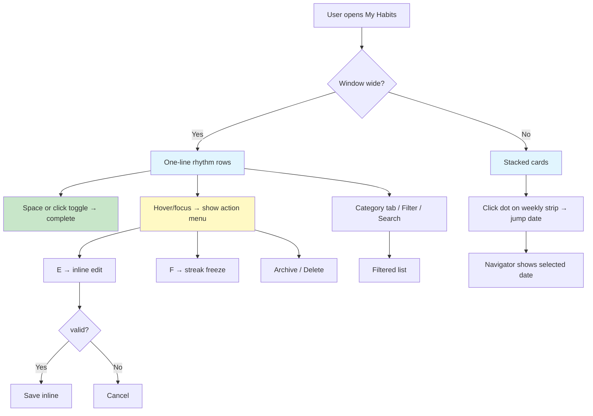

# Synchron - My Habits Screen Redesign Plan

## Vision

Rethink the My Habits screen as a **rhythm-first experience** where the habit's schedule is the organizing principle. Instead of a static card/table filtered by "today," the interface presents habits as living daily rhythms that persist across the chosen date navigator, making completion effortless, editing intuitive, and progress immediately understandable in both appearances and window sizes.

---

## 1. Redesign Objectives Mapped to Apple Design Principles

| Principle | Objective for My Habits |
|-----------|------------------------|
| **Purpose** - Make something meaningful | Surface the *daily completion rhythm* as the primary affordance. Each habit row answers "Is this done today?" instantly, with completion toggled in one tap/keypress. |
| **Agency** - Let people do things their own way | Give users freedom to complete, skip, edit, freeze, archive without entering modes. Every action has an obvious undo path (archive → unarchive, edit → cancel, delete → command-palette restore). Keep keyboard-first shortcuts (`Space` toggle, `E` edit, `F` freeze, `Del` archive/delete). |
| **Responsibility** - Act in people's best interest | Transparent streak math, explicit streak-freeze state, and clear status labels (Completed / Incomplete / Off Day). No hidden behavior changes. |
| **Familiarity** - Build on what people know | Retain the category tab strip, search, property filters, grid/list toggles, and habit metadata (frequency, priority, project) people already use — but reorganize for clarity. |
| **Flexibility** - Adapt to diverse contexts | Single-column compact rows that stack into cards on narrow windows; responsive margins respecting safe areas; Dynamic Type-ready; light/dark/increased-contrast adapted with system colors. |
| **Simplicity** - Be clear and direct | Progressive disclosure: completion is immediate; details (frequency, streak, project, category) are compact and contextual; editing inline on the row instead of a full modal when simple. |
| **Craft** - Care about every detail | Subtle haptics/sound on toggle, Liquid Glass elevation for controls, smooth state transitions (checkmark → filled), precise spacing, truncated text with tooltips. |
| **Delight** - Make it human | Celebratory completion feedback (subtle animation, streak badge glow), a "Streak Freeze" snowflake, encouraging empty states, and a meaningful subtitle that reflects purpose. |

---

## 2. Layout Adaptability (window sizes × appearances)

Based on **layout.md** and **designing-for-macos.md**:

- **Primary layout (wide):** Single dense list/table-style row that fits on one line at default text size. Completion toggle at the leading end (thumb-reachable, one keystroke), habit identity (name, category/project badge), frequency, streak, then a compact contextual action cluster at the trailing end.
- **Narrow windows:** Rows auto-stack: completion toggle on its own leading cell, name + badges wrapped in the middle, controls in a small inline menu (kebab `⋯`) to avoid clutter. This respects the Flexibility principle — functionality stays the same, only layout changes.
- **Both appearances:** Use CSS custom properties (`var(--bg-surface)`, `var(--text-primary)`, `var(--border-color)`, `var(--accent-teal)`, `var(--item-completed)`) so the design adapts to light, dark, and system accent. Liquid Glass elevation for the row surface and control cluster per **color.md**.
- **Avoid controls at window bottom** (macOS guideline): keep scrolling list, never bottom-fixed critical actions.
- **Safe-area awareness:** respect top camera housing area via safe-area insets.

---

## 3. Rhythm-First Habit Presentation

Instead of showing a habit only on "today," the **date navigator becomes the rhythm axis**:

- The habit list is *scoped to the selected date* but each habit **always shows its frequency badge** ("Daily", "Weekdays", "Weekends") and its **schedule context** on the selected date ("On today", "Off today", or a weekday name for weekdays/weekends).
- For non-daily habits, the list shows habits both **scheduled for the selected date** (top group) and **not scheduled** (collapsed group below), so users aren't surprised when a habit "disappears."
- The **Streak badge** sits next to the habit name (leading), giving immediate momentum context.

---

## 4. Compact Weekly Visualization

Per the user's request to "explore compact weekly visualizations" — a small **7-dot weekly pattern strip** per row:

- A single row displays **7 tiny circular dots** representing the habit's recurring schedule across the current week (Mon–Sun or Sun–Sat per `appSettings.weekStart`).
- Each dot is filled for scheduled days, dim for off days. This tells the user "is this habit due this week?" at a glance.
- Clicking a dot **jumps the date navigator** to that day for that habit — a fast "what if I complete tomorrow?" exploration.
- This replaces oversized card progress bars with a dense, scannable micro-visualization — addressing the "avoid visual density" concern by keeping dots tiny (8px) and monochrome.

*Alternative considered and rejected:* a full 30-day heatmap per row is too dense; the 7-day strip is the right granularity for daily habits.

---

## 5. Contextual Actions and Inline Editing

**Action cluster** (trailing end of row, per **lists-and-tables.md** best practices for macOS tables):

- **Primary action (leading):** the completion toggle — a large, tappable checkbox/pill that also shows the current day's state ("Done" / "Mark").
- **Secondary actions:** freeze (`F` / snowflake), edit (`E`), archive (`⌘D`-ish). Grouped in a trailing `⋯` menu or exposed inline only when hovered/focused, keeping the row uncluttered.
- Per the **Simplicity** principle, edit is **inline**: clicking edit turns the habit name into an input field on the row itself (not a modal), with Save/Cancel appearing inline. Advanced properties (category, project, custom days) open a compact popover.
- **Undo:** every destructive action is recoverable via the archived list or command palette.

---

## 6. Improved Progress / Streak Visualization

- **Streak badge** (`StreakBadge` component, preserved): flame icon + count, placed leading next to the name. Its color adapts by appearance.
- **Completion state** on the selected date: the row's name subtly fades and a checkmark appears when done (`doneOnSelectedDate`), mirroring `Today.tsx`'s pattern.
- **Weekly strip dots** (above) double as a progress indicator for the current week.
- **Header summary** preserved: "X of Y Complete · Z%" and mandatory count, but styled as a subtle stat row above the habit list (Lighter weight, smaller type).

---

## 7. Category and Filtering Redesign

- **Category tab strip** preserved (role="group", `aria-pressed`) — familiar, keyboard-navigable.
- **Search bar** integrated into the toolbar alongside filter controls.
- **Property filter popover** (Priority, Frequency, Status) retained with same options, but redesigned as a compact side sheet-style popover with a "Clear filters" link, per macOS popover conventions.
- **Custom category manager** retained (rename/delete) as a secondary control.

---

## 8. Implementation Plan for `src/App.tsx`

### 8.1 Scope boundary
- Modify only the My Habits screen: `renderHabits()` section (~lines 2758–3231) plus supporting rendering helpers (`renderHabitRow`, `renderHabitGridCard`) (~lines 2206–2529).
- **Do not modify:** Today, Tasks, FocusTimer, History, Analytics, Projects, Onboarding, settings.

### 8.2 Preserved behavior
- All `Habit` data structures and properties untouched.
- `toggleHabit`, `toggleHabitFreeze`, `archiveHabit`, `unarchiveHabit`, `startEdit`, `saveEdit`, `cancelEdit`, `requestHabitDeletion`, `deleteCategory`, `renameCategory`, `addHabit`, `addFocusSessionRecord`, filter/sort logic unchanged.
- Keyboard interactions preserved (`Space` toggle, arrow navigation, Enter/Escape in edit, `E`/`F`/`Del` shortcuts via command palette).
- Persistence (localStorage) unchanged.

### 8.3 New rendering strategy
1. Introduce `useMemo`-computed `scheduledHabits` / `offDayHabits` groups for the selected date (reuse existing `activeHabits` / `offDayHabits`).
2. Replace `renderHabitRow` / `renderHabitGridCard` with a **unified `renderHabit(habit, {mode, isScheduled})`** component:
   - At wide width → single-row "table row" look.
   - At narrow width → stacked card.
   - Detect width via a `ResizeObserver` on the main container → `listWidth` state → choose rendering mode.
3. New helper `weeklyScheduleDots(habit, dateKey, weekStart)` → returns array of 7 dot states.
4. New helper `habitActionMenu` → trailing contextual menu.
5. Inline edit UI: `editingId` toggles a compact inline editor inside the row (name input + Save/Cancel), with advanced properties in a popover.

### 8.4 New CSS (in `src/styles/index.css`)
- `.habit-rhythm-row` — one-line dense row with flex columns: toggle, identity, schedule-strip, streak, actions.
- `.rhythm-toggle` — large completion button with check/fade states.
- `.weekly-strip` — 7-dot strip, flex gap 3px.
- `.rhythm-row.narrow` — stacked variant with inline `⋯` menu.
- `.rhythm-row.editing` — inline editor state.
- Media-driven width classes instead of viewMode-based grid cards (grid mode → card-style stacked rows).

### 8.5 Accessibility (per accessibility.md)
- `aria-pressed` on the toggle, `aria-expanded` on menus, `role="group"` on category tabs.
- High contrast maintained: completion state also signaled by a checkmark glyph, not color alone (**inclusive color**).
- Streak freeze signaled by snowflake icon + text label.
- Keyboard: row `tabIndex={0}`, `onKeyDown` for Space (toggle), E (edit), F (freeze), Del (archive), Enter (select/expand), Escape (cancel edit) — preserving existing shortcut semantics.

### 8.6 Testing & verification
- Run the full test suite: `npm test` (existing tests must pass — the task says preserve all functionality).
- Visual check in light/dark appearance.
- Test resize (narrow → wide) for layout switching.
- Verify keyboard-only navigation through the list.

---

## 9. Mermaid: Interaction Flow

---

## 10. Risks & Mitigations

| Risk | Mitigation |
|------|-----------|
| Row height grows at larger Dynamic Type | Rows use flexible flexbox; multi-line name allowed; dots wrap; no fixed heights. |
| 7-dot strip too dense on tiny windows | Dots shrink to 6px; strip collapses to a single "schedule" badge on ultra-narrow. |
| Breaking existing tests | Keep all handler signatures and state keys identical; renderers are UI-only. |
| Keyboard focus traps in inline edit | Escape key explicitly cancels and re-focuses row (existing behavior). |
| Dark-mode contrast on streak color | Reuse `StreakBadge` with appearance-aware tokens. |

---

## 11. Approval Gate

Before implementation: review this plan, confirm the **unified single renderer + ResizeObserver width detection + 7-dot weekly strip** approach, then switch to Code mode to implement.
